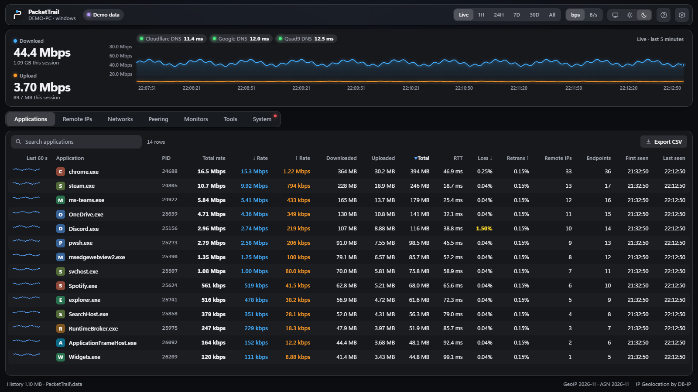

# PacketTrail

By Matthew Burnett · version 1.0.1 · MIT licence ·
**[Website](https://mattbrianb.github.io/packettrail/)** ·
**[Download](https://github.com/mattbrianb/packettrail/releases/latest)** ·
**[Donate](https://paypal.me/matthewbrianburnett)**



A portable per-application network traffic monitor. It shows which apps on a
PC talk to which remote IP addresses, how much data goes each way, and who
those IPs belong to: country, city, ASN and organisation, reverse DNS, and the
hostname the app actually looked up.

- One self-contained executable per platform. Nothing to install, no runtime
  needed, no cgo.
- Windows 10/11 x64 is the primary target. Linux and macOS builds are included
  but untested (see [Linux and macOS](#linux-and-macos)).
- Location and ASN lookups are offline (DB-IP Lite databases) and cached.
  What leaves the PC: reverse-DNS queries to your configured DNS server;
  anonymous PeeringDB lookups by AS number (Peering tab); the probes you start
  (diagnostics, monitors, route map, and a few ICMP probes towards 1.1.1.1
  for ISP detection, at most every 6 hours); and the free DB-IP Lite GeoIP
  databases (about 135 MB), downloaded once on first start and afterwards
  only when you click *Download latest* (turn the first-start download off
  with `--no-geoip-download`).

## Quick start (Windows)

1. Download `packettrail-windows-x64.zip` from the
   [latest release](https://github.com/mattbrianb/packettrail/releases/latest)
   and extract it anywhere (USB stick, network share, `C:\Tools\...`). The app
   keeps its `data` folder next to `packettrail.exe`, so move them together.
2. Double-click `packettrail.exe`. If Windows says "Windows protected your
   PC", click **More info**, then **Run anyway** (see
   [Antivirus, SmartScreen and trust](#antivirus-smartscreen-and-trust)).
3. Windows shows a UAC prompt.
   - **Yes** gives full capture: bytes per app, per remote IP, TCP and UDP,
     plus DNS names.
   - **No** gives connections-only mode: apps and remote IPs are listed, but
     with no byte counts and no UDP. You can switch later with the
     **Restart as administrator** button.
4. The dashboard opens in its own window. Closing the window stops the
   monitor.

**Why admin?** Per-process byte counts come from the Windows kernel's network
event provider (ETW `Microsoft-Windows-Kernel-Network`). Windows only lets
administrators enable it. Membership of *Performance Log Users* is not enough
for this provider.

**Check that capture works on a PC:** open an *administrator* terminal and run:

```
packettrail.exe --selftest 20
```

Browse a little while it runs. It prints the top apps and remote IPs with byte
counts and saves the report as `data\selftest-*.txt`.

## Antivirus, SmartScreen and trust

PacketTrail isn't code-signed, because that needs a paid certificate. It
runs normally without one. This is what to expect, and what helps.

- **On the build PC:** Microsoft Defender scanned this build of
  `packettrail.exe` and found no threats, and it has no record of ever
  flagging PacketTrail. Other antivirus products were not tested.
- **Why an antivirus might still flag it:** the app asks for admin rights,
  reads kernel network events, lists processes and sends ping and traceroute
  probes. Monitoring tools do all of these, but so does some malware, so
  heuristic scanners sometimes flag tools like this. Unsigned Go programs
  are also a common source of false positives.
- **SmartScreen on other PCs:** a file downloaded from the internet, or
  received by email or chat, carries a "came from the internet" mark. The
  first run then shows "Windows protected your PC": click **More info**, then
  **Run anyway**. To clear the mark before running, right-click the exe →
  *Properties* → tick **Unblock** → *OK*, or run
  `Unblock-File .\packettrail.exe`. A file copied from a USB stick doesn't
  get the mark unless it already had it.
- **Check a copy is genuine:** the build writes `SHA256SUMS.txt` next to the
  executables. On the other PC, `Get-FileHash .\packettrail.exe` must show the
  same SHA-256 as the line for `packettrail.exe`.
- **If an antivirus blocks or quarantines it:**
  1. Check the hash as above.
  2. Report it as a false positive. It's free. For Microsoft Defender use
     <https://www.microsoft.com/wdsi/filesubmission> (choose *Software
     developer* for your own build). Other vendors have similar forms. Once
     the vendor updates its definitions, usually within a few days, that
     exact file is no longer flagged.
  3. If you need it running before then, add an exclusion for the Net
     Monitor folder in that antivirus. Do this only for a copy you trust: an
     exclusion turns scanning off for everything in the folder.
- **Keep one build per release:** Defender and SmartScreen reputation is tied
  to the exact file, and every rebuild produces a different file that starts
  from zero. Give everyone the same `packettrail.exe` and keep it until
  there's a reason to change it.
- **Why not a self-signed certificate:** it is only trusted on PCs where you
  install that certificate as trusted, which is a security change on each PC.
  It does nothing for SmartScreen or antivirus reputation anywhere else.
- **The only free route to a real signature:** SignPath Foundation signs
  open-source projects at no cost. That would mean publishing PacketTrail's
  source on GitHub and building releases there.

## Using the dashboard

New users get a **guided tour** the first time the app opens (Back, Next,
Esc to leave). The **?** button in the toolbar, or **F1**, opens **Help**:
the views, what each column means, diagnostics, keyboard shortcuts, what
leaves the PC, troubleshooting, and a button to replay the tour.

| Area | What it shows |
|---|---|
| Toolbar | Capture status (with an inline *Restart as administrator* button when byte counts are unavailable), period (*Live, 1H, 24H, 7D, 30D, All*), bps ↔ B/s, appearance (*System, Light, Dark*), help, settings |
| Overview | Current download and upload rate with totals, plus the traffic chart. *Live* shows per-second traffic for the last 5 minutes; other periods show the average rate over the period for all apps. Hover the chart for exact values. |
| **Applications** | Every process with network activity, with its own icon (extracted from the executable on Windows), 60-second sparkline, PIDs, current ↓/↑ rate and the combined **Total rate** (sort by it to catch whatever is using the most bandwidth right now; it re-sorts live), bytes down/up/total, number of remote IPs and endpoints, first and last seen. Click an app to open its details. |
| App detail | Slides in from the right over the list, like a sub-window, while the app list stays visible on the left. Click another app to switch. Click the same app again, anywhere outside the panel, the ✕ or Esc to close it; the toolbar (period, units, appearance) leaves it open. Shows the app's rates, totals, RTT and loss as tiles, its traffic chart, and **every remote IP / port** it talked to: protocol, direction, DNS hostname, rates, bytes, path quality, country, city, ASN, AS organisation, reverse DNS, first and last seen. |
| **Remote IPs** | The same, aggregated per remote IP across all apps, with country flags, the apps and ports involved. *Hide LAN / private* removes RFC 1918, CGNAT, link-local and similar ranges. Click a row for full details. |
| **Networks (ASN)** | Traffic aggregated per ASN, with countries, IP count and apps. Click a row to see which of the network's prefixes and IPs carry your traffic. Useful for routing and peering decisions. |
| **Peering**, **Monitors** | See [Path quality, peering and monitors](#path-quality-peering-and-monitors). |
| **Tools** | Run MTR, traceroute, ping or a TCP port check to **any** IP address or hostname, including ones this PC hasn't talked to. See [Tools tab](#tools-tab). |
| **System** | CPU, memory, disks, network adapters, the TCP/IP stack and processes, with a list of things worth checking. See [System monitor](#system-monitor). |

- **Period:**
  - *This session (live)* is in-memory data since the monitor started; tables
    refresh every 2 s.
  - *Last hour / 24 hours / 7 days / 30 days / All history* come from the
    history database and include previous runs.
- **Sorting:** click any column header to sort; click again to reverse. IPs
  sort numerically, and empty values always sort last. Each table remembers
  its sort.
- **Filter:** type in the filter box to narrow a table. It matches any column
  (IP, hostname, country, `AS13335`, app name, …). Separate words with spaces
  and a row must match all of them. Press `/` to jump to the filter.
- **Export CSV:** saves the current table (current period, filter and sort,
  *all* rows) to your Downloads folder.
  - Numbers are raw: bytes and bytes/s as integers, so locale decimal
    separators don't matter.
  - Times are `YYYY-MM-DD HH:MM:SS` local time.
  - The file is UTF-8 with a BOM so Excel opens it correctly. The delimiter is
    your Windows list separator.
- **Details panel:** click a row in *Remote IPs*, *Networks* or *Peering* (or
  press Enter on it) to open its details in an inspector panel that slides in
  from the right, while the table stays usable on the left. Click another row
  to switch. Click the same row again, anywhere outside the panel, the ✕ or Esc to
  close it; the toolbar (period, units, appearance) leaves it open. Inside an app's
  panel, its endpoint rows expand in place instead.
  - For an IP: every hostname apps looked up for it, reverse DNS, routed
    prefix, ASN, location with flag, traffic, and which apps and ports used
    it.
  - For a network: the prefixes carrying your traffic and its busiest IPs.
    Click one of those IPs to jump to it.
  - Press Esc to close. Nothing opens an external website.
- **Diagnostics:** every IP panel has *MTR*, *Traceroute*, *Ping* and *TCP port* tools.
  To test an address that isn't in the tables, use the [Tools tab](#tools-tab).
  - **MTR** probes every hop each second and keeps loss, last, avg, best,
    worst and stdev per hop. Each hop shows its reverse DNS, ASN,
    organisation and location, plus a best/avg/worst latency bar.
  - **Traceroute** maps the path once (three probes per hop).
  - MTR and traceroute results start with a **path diagram**: your PC on the
    left, then each hop as a dot with its latency, grouped into coloured
    bands per network (your LAN, your ISP, an internet exchange, transit,
    the destination). Yellow and red dots mark hops with loss, and a dashed
    line marks hops that didn't answer. Network bands show the compact ASN;
    hover a band or dot for the full organisation name. Exchange LANs that aren't announced in BGP are recognised from
    their reverse DNS (for example `….ixp.durban`). Private addresses count
    as **your LAN** only until the path first leaves it: a later hop that
    answers from a private address is a provider's router. It is shown
    inside the network whose hops surround it, or as **Private IPs** when
    the networks on each side differ.
  - **Ping** shows loss, min/avg/max and jitter, with an RTT bar strip.
  - **TCP port** times the TCP handshake to a port, for paths that filter
    ICMP. It defaults to the port the app used.
  - *Copy results* gives an mtr-style text report.
  - Probes go only to the IP you chose, and a run stops when you close the
    panel, start another test in the Tools tab, or after 15 minutes. At most
    four run at once.
  - On Windows these use the same system ICMP API as `ping.exe` and
    `tracert.exe`, so they work without admin. On macOS they also work as a
    normal user. On Linux, MTR and traceroute need root to see intermediate
    hops.
  - The first round walks outward a few hops at a time and stops at the
    destination, and probes leave a few milliseconds apart. A burst of pings
    to one host gets rate-limited, which would show up as false loss on the
    last hop.
- **Copying:** IPs are plain selectable text. Live updates pause while you have
  text selected in a table, so a selection isn't wiped by the 2-second
  refresh. Every IP, hostname, prefix and ASN has a copy button (it appears on
  hover in the tables). *Copy details* copies the whole panel as text.
- **Port column:** `→ 443` means the app connected *out* to remote port 443.
  `← 3389` means a remote host connected *in* to local port 3389. Inbound
  traffic is grouped by local port, so a server doesn't produce one row per
  client port.
- **Appearance:** *System* follows Windows, while *Light* and *Dark* override
  it. The window's title bar follows the choice. The setting is remembered,
  and the app also respects Windows' reduce-motion, transparency-effects and
  high-contrast settings.
- **Traffic colours and glow:** *Settings → Appearance* sets the download
  and upload colours:
  - A choice is a whole data palette: it colours every chart and data bar.
    Download and upload use its two named colours; on the System tab CPU and
    the per-core bars follow download, disk follows upload, and two matching
    colours cover memory and kernel time, and TCP retransmits. Buttons stay
    blue.
  - Seven presets, download colour first, each graded like a film look:
    *Blue & orange* (the default, and the easiest pair for colour-blind
    viewers), *Green & yellow* (phosphor green and gold), *Green & red*
    (emerald and crimson), *Blue & red*, *Cyan & magenta* (neon), *Lime &
    purple* and *Blue & ice* (deep blue and frost). Lines and dots use
    vivid shades; small text uses a darker shade of the same colour in
    light mode so it stays readable (4.5:1 contrast or more). Green & red is
    the hardest pair for colour-blind viewers. Pairs with red, yellow or
    green share those colours with the status dots.
  - *Custom*: pick any two exact colours with the colour picker, or type hex
    codes such as `#43afff`. They are used as-is in both light and dark
    mode, and an inline note warns when a colour would be hard to read in
    either.

  Status dots and loss figures always stay green, yellow and red. *Glow in
  dark mode* turns the soft halo around chart lines and status dots on or
  off.
- **Units:** decimal (1 MB = 1,000,000 bytes, 1 Mbps = 1,000,000 bit/s).
- **Byte counts** are payload bytes: TCP/UDP data without IP/TCP/UDP headers.
  Totals are therefore a few percent lower than interface or router counters.
  TCP retransmissions are not counted twice.

### Tools tab

Type an IP address or hostname and press Enter (or click *Test*). The test
you used last (MTR the first time) starts straight away. Switch between MTR,
traceroute, ping and TCP port in the Diagnostics card.

- **What you can type:** an IPv4 or IPv6 address, a hostname, either with a
  port (`1.1.1.1:53`, `[2001:db8::1]:443`, `example.com:8443`; the port is
  used by the TCP check), or a pasted URL (`https://example.com/path` tests
  `example.com`).
- **Hostnames** are resolved with this PC's normal DNS resolver. If a name
  has several addresses, they are listed above the results (IPv4 first) and
  the first is tested; click another to test that one instead.
- **Below the test:** the same details as any IP panel: reverse DNS, routed
  network, ASN and location, plus any traffic this PC has had with the IP in
  the selected period.
- **Recent:** the last 8 targets you tested, one click to run again. They are
  kept in this app's local storage; *Clear* removes them.
- **From a monitor:** the MTR button on a monitor card opens the Tools tab and
  starts MTR to that target (a TCP check for TCP monitors).
- A test keeps running if you switch to another tab, until it finishes, you
  click *Stop*, or you start a new test.

## Path quality, peering and monitors

### Path quality (passive)

Every table has three path-quality columns. No probes are sent; the numbers
come from the operating system's own TCP statistics.

- **RTT:** the average TCP round-trip time.
- **Loss ↓ (est.):** the download side. It is the share of received segments
  where your PC saw a gap in the incoming data (a duplicate-ACK episode), so
  packets were lost or reordered on the way *to* you. Yellow above 0.5%, red
  above 2%. This is the useful one for download-heavy traffic such as
  streaming, updates and browsing, where your PC sends almost nothing and so
  has nothing to retransmit.
- **Retrans ↑:** the upload side. It is the share of sent bytes TCP had to
  retransmit. Yellow above 1%, red above 5%.

The app panel and the IP panel show the same figures as tiles.

| | Retrans ↑ | Loss ↓ | RTT |
|---|---|---|---|
| Windows | ETW Kernel-Network retransmit events (admin) | TCP extended statistics: duplicate-ACK episodes ÷ segments received, sampled every 5 s (admin) | TCP extended statistics, smoothed RTT (admin) |
| Linux | `tcp_info` total retransmits / bytes retransmitted (kernel 4.19+) | not available | `tcp_info` smoothed RTT |
| macOS | `nettop` `re-tx` column | not available | `nettop` `rtt_avg` column |

In connections-only mode (Windows without admin) these columns stay empty.
Loss ↓ is an estimate: reordering also triggers duplicate ACKs, and one
episode can cover several lost packets.

### Peering

The **Peering** tab shows how your traffic leaves your network.

- **Your network:** found automatically from the first public hop on the path
  to 1.1.1.1. That is, it's the network of the router that hands you to the
  internet. Click **Change** to enter your own AS numbers instead. That's
  useful if you work for the ISP or use a VPN; for example, add your
  employer's or VPN provider's AS number so its traffic counts as on-net.
- **Traffic mix:** on-net (your AS numbers), off-net and local/private
  traffic, plus how concentrated the off-net traffic is.
- **Off-net networks:** ranked by volume with share, rates, bytes, RTT and
  retransmits. **Share** is a network's downloaded + uploaded
  bytes divided by all off-net bytes in the selected period: of everything
  this PC exchanged with networks outside your own, how much went to this
  one. Traffic to your own network (on-net) and LAN addresses isn't counted,
  because peering can't move it. A line above the table shows the off-net
  total it is measured against. A high share with no shared exchange is
  where peering would move the most traffic off transit. For the top 25 networks it adds PeeringDB data: network type,
  peering policy, exchange count, the **exchanges you have in common**, and a
  short peering hint such as "Open policy, 4 common IX". Click a row to see
  every exchange with port speed and route-server peering in the details
  panel; shared ones are listed first.
- **Route map:** click *Route map* to trace the path to the busiest IP of each
  of your top 8 networks (4 at a time, two probes per hop, about a minute in
  total). The paths are merged into one tree, so you can see where they share
  your ISP's routers, where each one **leaves your network** (ringed dot), and
  whether it goes through an internet exchange or a transit network. A table
  below lists, per network, the traced IP, the exit router, the next network,
  whether an IX was used, the hop count and the RTT.
- **What leaves your PC:** PeeringDB lookups send the AS numbers being looked
  up to peeringdb.com. They are anonymous and batched: up to 10 networks per
  request, one request every 4 s. If PeeringDB asks clients to slow down
  (HTTP 429), the monitor waits as long as it's told and the note above the
  table says so. Results are cached in the history database for 7 days
  (1 day for networks without a record). Detection sends a handful of ICMP
  probes towards 1.1.1.1, at most every 6 hours. The route map sends normal
  traceroute probes to the 8 chosen IPs, only when you click it.

### Monitors

The **Monitors** tab keeps pinging chosen targets in the background,
smokeping-style, even when you're looking at other tabs.

- **Adding monitors:** type an IP or hostname and choose *Ping* (ICMP) or
  *TCP* (handshake to a port), with an interval of 1–30 s. You can also click
  one of the suggestions (your default gateway, your DNS servers, 1.1.1.1,
  8.8.8.8), or **Monitor** in any IP's Diagnostics card.
- **Each card** shows last, average, min/max, jitter and loss, plus a chart:
  a min–max band, the average line, and red marks for loss. The chart follows
  the period selector: *Live* shows raw probes for the last ~10 minutes;
  other periods show per-minute history from the database.
- **Overview:** the first four monitors also appear as status chips. Green
  means fine; yellow means some loss or spikes; red means heavy loss or three
  lost probes in a row.
- **Limits and controls:** up to 20 monitors. Pause/resume with the button on
  the card; removing a monitor (click ✕ twice) deletes its history.
  **Pause all** (top right of the list, next to the running count) stops
  probing for every monitor at once and keeps their history; it turns into
  **Resume all** once everything is paused, which restarts every monitor,
  including any you had paused one by one. The paused state survives a
  restart of the app.
- **Hostnames** are re-resolved every 5 minutes.

## System monitor

The **System** tab helps rule the PC itself in or out when the network looks
bad. It samples every 2 s in the background and keeps 15 minutes of history.

- **Tiles:** CPU, memory, disk activity and TCP retransmits over the last
  minute, each with a 5-minute sparkline.
- **Things to look at:** plain-language findings, worst first. Short spikes
  are ignored; most checks need a condition to last about 30 s.

  | Check | Flags when |
  |---|---|
  | CPU | above 75% (yellow) or 90% (red) for 30 s; or one core pinned near 100% while the total is low |
  | Interrupt / DPC time (Windows) | above 8% for 30 s. That is usually a network, Wi-Fi, storage or audio driver, and it causes latency spikes. |
  | Memory | above 85% / 92% used; commit charge above 90% of the limit; heavy swap use |
  | Disk space | under 2 GB free, or under 10% and under 20 GB |
  | Disk activity | busy above 90% for 30 s, or average response time above 50 ms |
  | Adapters | any packet errors in the last minute; a steady stream of discards; a link over 85% utilised; Ethernet negotiated at 100 Mbit/s or less (cable or port problem); Wi-Fi link rate under 50 Mbit/s |
  | TCP | more than 2% of sent segments retransmitted over the last minute, once there's real traffic (≥ 3,000 segments and ≥ 30 retransmits, so a few SYN retries to a dead host don't count) |
  | UDP | datagrams dropped because an app's receive buffer was full |

  When a check fires while you're on another tab, the *System* tab shows an
  yellow or red dot.
- **Last 15 minutes:** CPU, memory and disk-busy percentages on one chart.
- **Processors:** per-core load, and the split between user, kernel, DPC and
  interrupt time (Windows) or user, system, IRQ, I/O wait and steal (Linux).
- **TCP / IP stack:** machine-wide segments in and out, retransmitted share,
  established connections, resets sent, failed connection attempts, TCP
  receive errors, and UDP traffic and drops.
- **Network adapters:** type (Ethernet, Wi-Fi, VPN, virtual), link speed,
  current rates, utilisation of the link, errors and discards (last minute and
  since boot), MTU and MAC.
- **Disks:** used, free and size per volume.
- **Processes:** CPU (share of the whole machine), memory (private working
  set), I/O rate, threads and handles. The capture adds each process's own
  network rate. Searchable, sortable and exportable like the other tables.

Where the figures come from:

| | Windows | Linux | macOS |
|---|---|---|---|
| CPU | `NtQuerySystemInformation` per-processor times, including DPC and interrupt | `/proc/stat` | `iostat` (total only, no per-core) |
| Memory | `GlobalMemoryStatusEx` | `/proc/meminfo` | `vm_stat`, `sysctl` |
| Disk activity | Performance counters (PhysicalDisk) | `/proc/diskstats` | `iostat` (MB/s only) |
| Adapters | `GetIfTable2` | `/proc/net/dev`, `/sys/class/net` | `netstat -ibn`, `ifconfig` |
| TCP / UDP stack | `GetTcpStatisticsEx`, `GetUdpStatisticsEx` | `/proc/net/snmp` | `netstat -s` |
| Processes | `NtQuerySystemInformation` | `/proc/<pid>` | `ps` |

None of this needs admin rights. On Linux, other users' process I/O and paths
need root.

## Command-line options

```
packettrail.exe [options]
  --browser        open the dashboard in your default browser instead of a window (uses less RAM)
  --headless       no UI; capture in the background and serve the dashboard (print its URL)
  --no-elevate     do not show the UAC prompt at start (connections-only unless already admin)
  --limited        force connections-only mode
  --port N         dashboard port on 127.0.0.1 (default 47810; a free port is used if taken)
  --data DIR       data folder (default: "data" next to the executable)
  --retention N    days of history to keep (default 90)
  --loopback       include 127.0.0.1 / ::1 traffic (e.g. app -> local proxy/VPN client)
  --selftest N     capture for N seconds, print a diagnostic report, exit
  --demo           test aid: real connections with synthetic byte counts, stored in packettrail-demo.db
                   (shows the computer name as DEMO-PC, for screenshots)
  --no-geoip-download
                   do not download the DB-IP Lite databases automatically on first start
  --version
```

If the monitor is already running, starting it again opens the running
instance's dashboard in your browser instead of starting a second capture. The dashboard
listens on `127.0.0.1` only. It rejects requests with a foreign `Host` header
and cross-site POSTs.

## Resource use (measured on this PC)

| | RAM (private) |
|---|---|
| Monitor process (capture, history, web server, system sampler) | ~68 MB |
| Built-in window (WebView2, GPU disabled to save memory) | ~130 MB more |
| `--browser` mode | only one tab in your existing browser |

With the System tab open and refreshing every 2 s, the monitor process used
about 0.2% of one core on a 12-thread PC in demo mode. These figures were
measured in demo and connections-only mode. CPU and memory
under real ETW capture on a busy link have not been measured yet. ETW
delivers one event per send/receive, so expect more CPU during large
downloads.

If RAM is tight, use `--browser`, or `--headless` and open the URL when you
need it.

History is stored at 5-minute resolution for two days, then rolled up into
hourly buckets. Data older than `--retention` days is deleted. Growth is
estimated (not yet measured) at a few MB per busy day.

## Data folder

The folder is `data\` next to the exe. If that isn't writable, it falls back
to `%APPDATA%\packettrail`.

| File | Purpose |
|---|---|
| `packettrail.db` | SQLite history. Tables: `apps`, `flows` (5-minute buckets per app × protocol × remote IP × port × direction, hourly after 2 days), `app_series` (per-app per-minute totals), `ipinfo` (cached reverse DNS and DNS names), `monitors` and `monitor_series` (per-minute results), `peeringdb` (cached records), `meta` (settings such as your own AS numbers). `flows` also holds retransmitted bytes, RTT sums and download-loss counters. Older databases are upgraded automatically on start. Open it with any SQLite tool for your own queries. |
| `dbip-city-lite.mmdb`, `dbip-asn-lite.mmdb` | Offline GeoIP and ASN databases. Use *Settings → Download latest* to update them (published monthly). MaxMind `GeoLite2-City.mmdb` / `GeoLite2-ASN.mmdb` are used instead if the DB-IP files are absent. |
| `packettrail.log` | Start-up and error log |
| `webview2\` | Cache of the built-in window |

To move the monitor to another PC, copy the folder. To remove it, delete the
folder.

## How it works

| | Windows | Linux | macOS |
|---|---|---|---|
| Bytes per process and remote IP | ETW `Microsoft-Windows-Kernel-Network`, real-time session (admin) | `sock_diag` netlink: per-socket kernel counters (`tcp_info` bytes_acked / bytes_received), polled every second | `nettop` per-socket counters (TCP, UDP and QUIC), read about once a second |
| UDP | ETW (admin) | AF_PACKET socket with a UDP-only BPF filter, attributed via the UDP socket table (root) | `nettop` |
| Short-lived TCP connections | always seen | caught via sock_diag destroy notifications (root); without root, connections shorter than 1 s may be missed | may be missed (2 s polling) |
| "Hostname the app looked up" | ETW `Microsoft-Windows-DNS-Client` event 3008 (per process), plus the Windows DNS cache | parsed from DNS responses on UDP/53, including systemd-resolved's 127.0.0.53 (root) | not available (reverse DNS only) |
| Without admin/root | connections only (TCP table), no bytes | TCP bytes; only your own processes map to an app, others show as `(user …)`. No UDP, no DNS names. | should work (nettop normally needs no root) |

Enrichment covers every public IP:
- Country, region and city from DB-IP Lite City.
- ASN and organisation from DB-IP Lite ASN.
- Reverse DNS (PTR) via your system resolver: 4 parallel lookups, cached for
  7 days (failures for 1 day).
- Private, loopback, link-local, CGNAT, multicast, documentation and reserved
  ranges are labelled and never looked up.

### Things to know when reading the numbers

- **VPN, proxy and acceleration tools** (FortiClient, Windscribe, ExitLag,
  NetLimiter): traffic is attributed at the TCP/UDP socket layer.
  - With a full-tunnel VPN you see each app's traffic to its real destinations
    (inner traffic), plus the VPN client's encrypted traffic to the VPN server.
  - With a local proxy or redirector you see app → `127.0.0.1` (hidden unless
    you use `--loopback`) and proxy-process → real destination.
- **Browsers using DNS-over-HTTPS** (Chrome/Edge/Firefox "Secure DNS") bypass
  the Windows DNS client. The *Hostname (DNS)* column then stays empty for
  them, and *Reverse DNS* is the fallback. Turning Secure DNS off in the
  browser restores the names.
- **svchost.exe** is split per hosted service, for example
  `svchost.exe (wuauserv)`, so Windows Update, Delivery Optimisation and
  similar services are separate rows.
- **"This session"** keeps flows that were idle for more than 6 hours out of
  memory. History is unaffected.

## Linux and macOS

> **Lightly tested.** The Linux window has been run under WSL (Ubuntu 24.04).
> The macOS app is built and run on GitHub's Mac (macOS 26, Apple silicon) by
> the `macOS test` workflow: it checks that traffic is attributed to apps and
> remote IPs, and that the window and icon appear. Neither has had the daily
> use the Windows build has. Please report what you see.

Both open the dashboard in **their own app window**, like on Windows, using
the system's WebKit. If that can't start, PacketTrail uses a Chrome, Edge,
Chromium or Brave app window, and otherwise your default browser.

**macOS, easiest:** paste this into Terminal. It downloads the right build,
checks it against the release's SHA-256 checksum, puts **PacketTrail.app** in
*Applications* and opens it. A copy fetched this way isn't quarantined, so
macOS opens it without a security prompt:

```bash
curl -fsSL https://mattbrianb.github.io/packettrail/install.sh | bash
```

**macOS, by hand** (`packettrail-macos-arm64.zip` for Apple silicon,
`packettrail-macos-x64.zip` for Intel):

1. Unzip it and drag **PacketTrail.app** to *Applications*.
2. Open it. PacketTrail isn't notarised by Apple (that needs a paid developer
   account), so the first time macOS says it can't verify the developer.
   Click **Done**, then open *System Settings → Privacy & Security*, scroll
   down and click **Open Anyway** next to PacketTrail. On macOS 14 and earlier you
   can instead right-click the app, choose **Open**, then **Open**.
3. If your company's security software (e.g. Netskope, CrowdStrike) blocks it,
   your IT team has to allow it.

Terminal alternative for step 2:
`xattr -dr com.apple.quarantine /Applications/PacketTrail.app`. History and
settings live in `~/Library/Application Support/packettrail`.

**Linux** (x86-64 or arm64):

```bash
tar xzf packettrail-linux-x64.tar.gz
cd packettrail-linux-x64
./packettrail --install       # adds PacketTrail to your applications menu, then start it from there
./packettrail                 # or run it directly
sudo ./packettrail            # full capture (all processes, UDP, DNS); opens in your browser
```

The app window needs WebKitGTK 4.1, which most desktops already have
(`sudo apt install libwebkit2gtk-4.1-0` on Debian/Ubuntu,
`sudo dnf install webkit2gtk4.1` on Fedora). Run as root, PacketTrail opens your
browser as the desktop user instead of a root window. The Linux build uses a
`data` folder next to the binary (or `~/.config/packettrail` if that folder isn't
writable).

On both systems the free GeoIP databases download on first start, or later
via *Settings → Download latest*.

What's weaker than on Windows, and why:
- **Linux without root** has no UDP and no DNS names, and can only attribute
  your own processes. That's a kernel permission rule, not a missing feature.
- **Linux in general** polls TCP counters once a second instead of getting
  per-packet events. eBPF would be more precise, but it needs a C/clang
  toolchain to build the probe, which this project avoids.
- **macOS** depends on the text output of Apple's `nettop`. If a future macOS
  changes that format, capture breaks until the parser is updated. DNS names
  are not captured.
- **System tab on macOS** is built from `iostat`, `vm_stat`, `netstat`,
  `ifconfig`, `df` and `ps`, because reading the kernel directly would need
  cgo. As a result there's no per-core CPU, no disk busy time or latency, and
  no thread or handle counts. Wi-Fi link speed isn't shown either.
- **Loss ↓** (download-side loss) is Windows-only.

## Licences and attribution

PacketTrail is © 2026 Matthew Burnett. The publisher and copyright appear in the
Windows file properties of `packettrail.exe` (*Details* tab), in Task
Manager, in *Settings → About* and in `packettrail --version`.

The executable is not code-signed, so Windows still shows "Unknown
publisher" when it asks for administrator rights. See
[Antivirus, SmartScreen and trust](#antivirus-smartscreen-and-trust).

Third-party components:

- **IP geolocation by [DB-IP](https://db-ip.com)**: DB-IP Lite databases,
  licensed [CC BY 4.0](https://creativecommons.org/licenses/by/4.0/). Free
  for commercial use with attribution. The dashboard footer carries the
  required link.
- **Country flags**: the
  [Twemoji Country Flags](https://github.com/talkjs/country-flag-emoji-polyfill)
  font (TalkJS, MIT), embedded in the executable.
  - The flag artwork is [Twemoji](https://github.com/jdecked/twemoji),
    licensed CC BY 4.0. Credited in *Settings*.
  - Licence text: `third_party/TwemojiCountryFlags-LICENSE.md`.
- Go libraries:
  - `modernc.org/sqlite` (BSD-3)
  - `github.com/oschwald/maxminddb-golang` (ISC)
  - `github.com/jchv/go-webview2` (MIT)
  - `golang.org/x/sys` and `golang.org/x/net` (BSD-3)
- The tool does not use ip-api.com or any other online lookup service. Those
  are typically non-commercial only.

## Building from source

The repository includes everything needed to rebuild except the toolchain.

```powershell
.\build.ps1            # vet + tests + build all five targets into .\dist
.\build.ps1 -SkipTests
.\release.ps1          # build, then package zips/tarballs + SHA256SUMS into .\dist\release
```

The website is plain HTML in `docs/`, published with GitHub Pages.

`build.ps1` uses the portable Go in `.toolchain\go` if present, otherwise `go`
from PATH (Go 1.27+). No C compiler is needed.

Layout:
- `cmd/packettrail`: entry point, self-test, demo mode, Windows resources
  (icon and manifest).
- `internal/capture`: OS backends behind one `Capturer` interface.
- `internal/core`: live aggregation and rates.
- `internal/store`: SQLite history.
- `internal/enrich`: GeoIP, ASN and PTR.
- `internal/web`: JSON API and the embedded dashboard.

Unit tests cover:
- An end-to-end ETW session test. It registers its own test providers, so it
  needs admin or *Performance Log Users*.
- All payload parsers.
- History rollup and retention.

Website screenshots can be regenerated with `node tools/screenshots.mjs`
(Node.js 22+ and Chrome). They use synthetic fixtures and never read live
traffic. The same command checks the website at desktop and mobile sizes.
